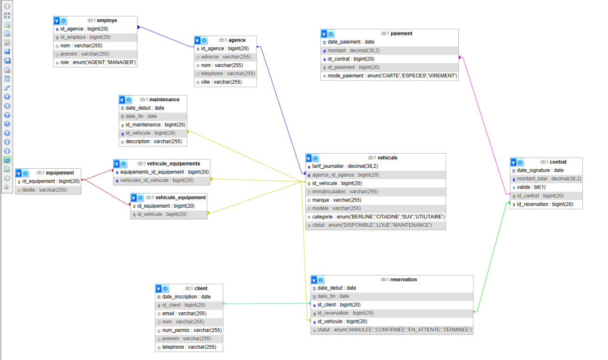

# Atelier 2 : associations, cascade et fetch

## Objectif

Le mapping JPA traduit le modèle AutoLoc tout en respectant le cycle de vie
métier des entités. Les associations utilisent explicitement `FetchType.LAZY`.
Les cascades sont limitées aux opérations attendues : une association ne signifie
pas automatiquement que les deux entités doivent être créées ou supprimées ensemble.

Les classes concernées se trouvent dans le package
[Domain](../src/main/java/tn/espritDigachiAhmed4iet4/Domain).

## Synthèse des choix

La cascade indiquée s'applique dans le sens de la flèche. Sauf mention contraire,
`orphanRemoval` vaut `false` et le côté inverse ne possède aucune cascade.

| Association | Fetch | Cascade | Justification métier |
|---|---|---|---|
| Contrat → Paiement | LAZY | ALL + orphanRemoval | Les paiements dépendent du contrat. Les opérations sur le contrat se propagent à ses paiements. Supprimer le contrat supprime ses paiements ; retirer un paiement de la collection d'un contrat géré entraîne aussi sa suppression au flush. |
| Agence → Véhicule | LAZY | Aucune | Le véhicule conserve un cycle de vie indépendant et peut changer d'agence. Les opérations sur l'agence ne doivent pas créer, modifier ou supprimer ses véhicules automatiquement. |
| Agence → Employé | LAZY | Aucune | Un employé peut être réaffecté. Supprimer une agence ne doit pas supprimer les employés. |
| Véhicule ↔ Équipement | LAZY | Aucune, des deux côtés | Les équipements sont partagés. Supprimer un véhicule ne doit pas supprimer ses équipements. Un `Set` des deux côtés évite les doublons d'objets selon leur égalité Java. |
| Client → Réservation | LAZY | PERSIST | La création d'un client peut persister ses nouvelles réservations. MERGE et REMOVE ne sont pas propagés : les réservations existantes se gèrent explicitement et leur historique doit être conservé. |
| Réservation → Véhicule | LAZY | Aucune | Le véhicule appartient au parc, pas au cycle de vie de la réservation. Il doit déjà être persisté ou être enregistré explicitement. |
| Véhicule → Réservation | LAZY | Aucune | Le lien inverse sert à consulter les réservations. Supprimer un véhicule ne doit pas effacer l'historique des locations. |
| Réservation → Contrat | LAZY | ALL | Le contrat accompagne la réservation : PERSIST, MERGE, REMOVE, REFRESH et DETACH sont propagés. `orphanRemoval` n'est pas activé ; retirer ou remplacer la référence ne supprime donc pas automatiquement l'ancien contrat. |
| Véhicule → Maintenance | LAZY | PERSIST | La création d'un véhicule peut persister ses nouvelles maintenances. Leur suppression n'est pas propagée pour préserver l'historique d'entretien. |

Les associations inverses Véhicule → Agence, Employé → Agence,
Réservation → Client, Maintenance → Véhicule, Contrat → Réservation et
Paiement → Contrat sont également `LAZY`, sans cascade. Une opération sur un
enfant ne doit pas supprimer son parent.

L'absence de cascade REMOVE ne garantit pas que la suppression d'un parent soit
autorisée par la base : les clés étrangères peuvent la bloquer. Les références
doivent alors être réaffectées ou retirées explicitement avant cette suppression.

## Multiplicités et côtés propriétaires

Le côté propriétaire écrit la clé étrangère ou la table de jointure.
`mappedBy` désigne le nom du champ Java propriétaire, et non une colonne SQL.

| Association | Annotations | Côté propriétaire / stockage | Côté inverse |
|---|---|---|---|
| Agence ↔ Véhicule | OneToMany / ManyToOne | `Vehicule.agence` : `vehicule.id_agence` | `Agence.vehicules`, mappedBy = `agence` |
| Agence ↔ Employé | OneToMany / ManyToOne | `Employe.agence` : `employe.id_agence` | `Agence.employes`, mappedBy = `agence` |
| Véhicule ↔ Équipement | ManyToMany / ManyToMany | `Vehicule.equipements` : table `vehicule_equipement`, colonnes `id_vehicule` et `id_equipement` | `Equipement.vehicules`, mappedBy = `equipements` |
| Client ↔ Réservation | OneToMany / ManyToOne | `Reservation.client` : `reservation.id_client` | `Client.reservations`, mappedBy = `client` |
| Véhicule ↔ Réservation | OneToMany / ManyToOne | `Reservation.vehicule` : `reservation.id_vehicule` | `Vehicule.reservations`, mappedBy = `vehicule` |
| Réservation ↔ Contrat | OneToOne / OneToOne | `Contrat.reservation` : `contrat.id_reservation`, contrainte UNIQUE | `Reservation.contrat`, mappedBy = `reservation` |
| Véhicule ↔ Maintenance | OneToMany / ManyToOne | `Maintenance.vehicule` : `maintenance.id_vehicule` | `Vehicule.maintenances`, mappedBy = `vehicule` |
| Contrat ↔ Paiement | OneToMany / ManyToOne | `Paiement.contrat` : `paiement.id_contrat` | `Contrat.paiements`, mappedBy = `contrat` |

Les noms des clés étrangères sont fixés par `@JoinColumn`; la table
Véhicule/Équipement est fixée par `@JoinTable`. La cascade ALL de
Réservation → Contrat est volontairement placée sur le côté inverse :
la propriété de la relation et la propagation du cycle de vie sont deux notions
distinctes.

Les deux côtés d'une association bidirectionnelle doivent être synchronisés en
Java. Par exemple, ajouter un paiement à `contrat.getPaiements()` doit aussi
s'accompagner de `paiement.setContrat(contrat)`. Une cascade ne renseigne pas
automatiquement la clé étrangère si le champ propriétaire n'est pas affecté.

## Stratégie de chargement

- Charger une agence ne doit pas charger systématiquement tous ses véhicules et
  employés ; charger un véhicule ne doit pas charger tout son historique,
  ses réservations et ses équipements.
- `LAZY` est une demande de chargement différé, pas une garantie d'absence de
  requêtes. En particulier, le côté inverse d'un OneToOne optionnel peut nécessiter
  une requête pour déterminer si le contrat existe. Le comportement réel dépend
  du fournisseur JPA et de l'instrumentation bytecode.
- Accéder aux associations nécessaires dans une transaction active. Pour une
  future API, construire des DTO plutôt que sérialiser directement tout le graphe
  d'entités.
- Pour un écran ou un traitement nécessitant une association, utiliser une requête
  ciblée avec `JOIN FETCH` ou un graphe d'entités. Cela limite les requêtes N+1 sans
  rendre toutes les associations EAGER.

## Conventions Clean Code

- Lombok ciblé : `@Getter`, `@Setter`, `@NoArgsConstructor`,
  `@AllArgsConstructor`, `@Builder` et `@ToString`, sans `@Data`.
- `@ToString.Exclude` sur les associations évite les récursions bidirectionnelles
  et les chargements déclenchés par l'affichage de ces relations.
- Nommage conservé pour rester cohérent avec les classes déjà présentes et le
  modèle du projet. Les champs de collection sont au pluriel.
- Aucun `@EqualsAndHashCode` automatique sur le graphe d'entités. Les `Set`
  utilisent actuellement l'identité Java des objets : deux instances distinctes
  représentant la même ligne ne sont pas automatiquement considérées égales.

## Capture de référence



Source : capture fournie par l'auteur, datée du 12 octobre 2026 à 11:46:05.
Elle illustre les tables et les liens visibles à cet instant, mais ne constitue
pas une validation complète du mapping final.

La capture montre aussi des traces d'un ancien schéma : la table
`vehicule_equipements` apparaît en plus de `vehicule_equipement`, et la colonne
`vehicule.agence_id_agence` apparaît au lieu de `vehicule.id_agence`.
Le mapping actuel attend uniquement la table de jointure `vehicule_equipement`
et la colonne `id_agence`. Ces traces doivent être vérifiées lors d'une nouvelle
génération dans une base de test dédiée ; aucune table n'a été supprimée pour
modifier cette capture.

## Validation et limites

Le test [DomainAssociationsTests](../src/test/java/tn/espritDigachiAhmed4iet4/Domain/DomainAssociationsTests.java)
vérifie :

1. La validité des métadonnées Hibernate pour les neuf entités.
2. Les propriétaires, `mappedBy`, noms des colonnes, table de jointure, types
   `Set`, fetch, cascades et `orphanRemoval` déclarés.
3. L'absence de récursion de `toString()` sur un graphe bidirectionnel.

Commande Windows :

```powershell
.\mvnw.cmd -Dtest=DomainAssociationsTests test
```

Ces tests s'exécutent sans connexion MySQL. Ils ne vérifient pas les suppressions
réelles au flush, les cascades en base ni le nombre de requêtes du chargement
différé. Ces comportements restent à tester dans une base isolée.

La configuration actuelle utilise `spring.jpa.hibernate.ddl-auto=update`.
Hibernate peut donc modifier le schéma au démarrage ; utiliser une base dédiée
à l'atelier et des migrations versionnées en production. Les identifiants de
production doivent être externalisés, sans être versionnés.

## API CRUD et utilisation avec Postman

Les neuf entités utilisent la même structure Repository → Service → Controller.
Le point POST véhicule existant est conservé. Aucun nouveau test automatisé
n'est ajouté pour cette extension ; les vérifications fonctionnelles se font
avec Postman. Une compilation ne valide pas les appels HTTP ni la persistance.

### Routes communes

Base : `http://localhost:8081/api`.

| Entité | Ressource |
|---|---|
| Agence | `/agences` |
| Employé | `/employes` |
| Client | `/clients` |
| Véhicule | `/vehicules` |
| Équipement | `/equipements` |
| Réservation | `/reservations` |
| Contrat | `/contrats` |
| Paiement | `/paiements` |
| Maintenance | `/maintenances` |

Pour chaque ressource :

| Action | Méthode et chemin | Réponse attendue |
|---|---|---|
| Créer | POST `/{ressource}/add` | 200 avec l'objet créé et son ID généré |
| Lister | GET `/{ressource}` | 200 avec une liste JSON, éventuellement vide |
| Consulter | GET `/{ressource}/{id}` | 200, ou 404 si l'ID n'existe pas |
| Modifier | PUT `/{ressource}/{id}` | 200, ou 404 si l'ID n'existe pas |
| Supprimer | DELETE `/{ressource}/{id}` | 204 sans corps, ou 404 si l'ID n'existe pas |

Pour POST et PUT, choisir **Body → raw → JSON** et
`Content-Type: application/json`. Les dates utilisent `yyyy-MM-dd`.
Les enums sont sensibles à la casse.

- En POST, omettre l'ID de l'objet principal ou fournir `null` ; un ID non nul
  est refusé avec 400 pour ne pas modifier une ligne existante par erreur.
- En PUT, l'ID du chemin fait autorité. Envoyer tous les champs simples et les
  associations propriétaires à conserver : il ne s'agit pas d'un PATCH.
  Une association propriétaire facultative omise est retirée ; omettre
  `equipements` ou envoyer `[]` retire les liens du véhicule, sans supprimer
  les équipements.
- Un ID nul ou non positif dans une référence est refusé avec 400. Une référence
  à une entité inexistante renvoie 404. Les services chargent les références
  existantes ; ils ne créent pas les objets liés implicitement.
- Un paiement doit référencer un contrat existant, en POST comme en PUT.
- Les contraintes SQL, notamment un second contrat pour la même réservation ou
  une suppression bloquée par une clé étrangère, renvoient 409.
- Les erreurs de lecture JSON et les erreurs HTTP gérées sont exposées au
  format Problem Detail avec un champ `detail`.

### Associations et JSON

Les collections inverses `Agence.vehicules`, `Agence.employes`,
`Client.reservations`, `Equipement.vehicules`, `Vehicule.maintenances`,
`Vehicule.reservations`, `Contrat.paiements`, ainsi que `Reservation.contrat`,
sont exclues des requêtes et réponses JSON. Cela évite les boucles de
sérialisation ; ce n'est pas une modification des cascades ou du fetch JPA.
Ces champs ne sont donc pas un moyen de créer ou modifier des enfants via HTTP.

Créer chaque enfant avec son endpoint et fournir la référence du côté
propriétaire. Par exemple, créer un paiement avec `contrat.idContrat` et un
contrat avec `reservation.idReservation`. Les autres propriétés d'un objet
référencé ne servent pas à le modifier : seul son ID est utilisé.

Les PUT modifient l'entité existante et préservent les collections inverses.
Un PUT sur un contrat ne doit pas effacer ses paiements par `orphanRemoval`.
La suppression d'un contrat continue à supprimer ses paiements ; celle d'une
réservation se propage à son contrat puis à ses paiements.
Les collections inverses ne figurant pas dans les réponses, consulter
`/paiements` ou `/contrats` pour vérifier ces suppressions.

Les associations propriétaires sont présentes dans les réponses. La configuration
Open EntityManager in View actuelle permet leur lecture pendant la sérialisation ;
ne pas désactiver ce mécanisme sans adapter le chargement ou introduire des DTO.
Les requêtes N+1 restent un point à surveiller pour de grandes listes.

### Exemples de création, dans l'ordre

Remplacer les IDs `1` par ceux réellement renvoyés par les requêtes précédentes.

**POST `/agences/add`**

```json
{
  "nom": "AutoLoc Tunis",
  "ville": "Tunis",
  "adresse": "10 avenue de la Liberte",
  "telephone": "71123456"
}
```

**POST `/equipements/add`**

```json
{
  "libelle": "GPS"
}
```

**POST `/clients/add`**

```json
{
  "nom": "Degachi",
  "prenom": "Ahmed",
  "email": "ahmed.degachi@example.com",
  "telephone": "22123456",
  "numPermis": "TN123456",
  "dateInscription": "2026-10-19"
}
```

**POST `/employes/add`**

```json
{
  "nom": "Ben Ali",
  "prenom": "Sami",
  "role": "AGENT",
  "agence": {"idAgence": 1}
}
```

**POST `/vehicules/add`**

```json
{
  "immatriculation": "123 TU 4567",
  "marque": "Renault",
  "modele": "Clio",
  "categorie": "CITADINE",
  "tarifJournalier": 90.00,
  "statut": "DISPONIBLE",
  "agence": {"idAgence": 1},
  "equipements": [{"idEquipement": 1}]
}
```

**POST `/reservations/add`**

```json
{
  "dateDebut": "2026-11-01",
  "dateFin": "2026-11-05",
  "statut": "EN_ATTENTE",
  "client": {"idClient": 1},
  "vehicule": {"idVehicule": 1}
}
```

**POST `/contrats/add`**

```json
{
  "dateSignature": "2026-10-19",
  "montantTotal": 360.00,
  "valide": true,
  "reservation": {"idReservation": 1}
}
```

**POST `/paiements/add`**

```json
{
  "montant": 360.00,
  "datePaiement": "2026-10-19",
  "modePaiement": "CARTE",
  "contrat": {"idContrat": 1}
}
```

**POST `/maintenances/add`**

```json
{
  "dateDebut": "2026-12-01",
  "dateFin": "2026-12-02",
  "description": "Vidange",
  "vehicule": {"idVehicule": 1}
}
```

### Vérification manuelle

1. Créer les objets ci-dessus et noter chaque ID.
2. Faire GET sur la liste puis sur l'ID de chaque objet.
3. Faire PUT sur cet ID avec le corps complet et un champ modifié, puis GET
   pour confirmer la modification. Vérifier aussi que modifier un contrat
   ne supprime pas ses paiements.
4. Vérifier 400 avec un enum inconnu ou une référence sans ID, 404 avec un ID
   inexistant, et 409 avec un second contrat lié à la même réservation.
5. Sur des données jetables, supprimer un contrat et vérifier que ses paiements
   ont disparu. Supprimer une réservation doit également supprimer son contrat
   et ses paiements.
6. Pour les liens sans cascade REMOVE, supprimer ou réaffecter explicitement les
   enfants avant le parent. Détacher les équipements via un PUT du véhicule
   avant de supprimer un équipement partagé.

Cette API fournit les opérations CRUD et la gestion des références existantes.
Elle ne constitue pas encore un moteur métier de location : la disponibilité
sur une période, les chevauchements de réservations, les transitions de statut
et le calcul automatique des montants ne sont pas implémentés.
